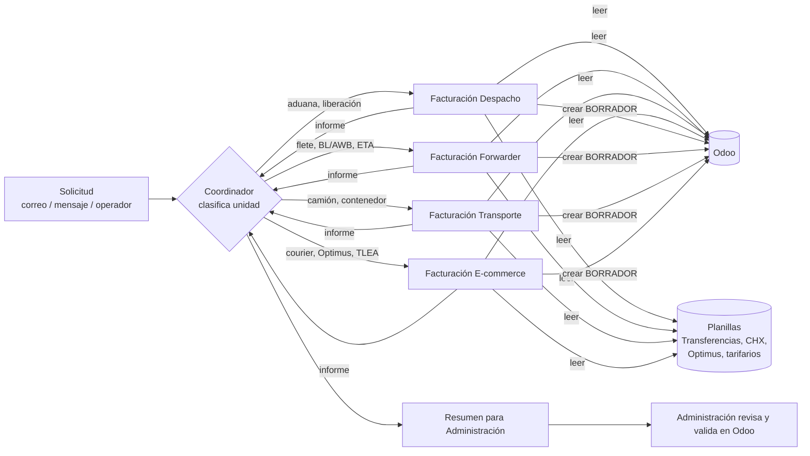

# Circuito de facturación Harbor Gateway (agentes)

Un **coordinador** recibe la solicitud de facturación y la deriva al **especialista** de la unidad que vende el servicio. Cada especialista busca los datos que necesita en Odoo y en las planillas operativas y **crea la factura en Odoo como borrador**. Administración la revisa y la valida.

Las reglas de cada unidad salen del *Manual de procesos de Harbor Gateway* (19/11/2026) y están en `facturacion/prompts.py`.



## Reglas de facturación por unidad

| Unidad | Cuándo se factura | Dónde busca los datos | Cuidado con |
|---|---|---|---|
| **Despacho** | Dentro de **48 h corridas desde la liberación** (no desde el ETA ni la oficialización) | Odoo (pase a facturación, compras), `transferencias` (fondos y VEP por cuenta y orden), MOA, tarifario | Honorarios separados de los gastos por cuenta y orden; DUX puede no estar accesible |
| **Forwarder** | Importación: **≥ 5 días corridos antes del arribo**. Exportación: *por validar* («antes de la salida» o «una semana antes») | Odoo (cotización aceptada, compras), documentos BL/AWB/MIC/CRT, tarifario | Las reemisiones no son servicios nuevos; los bidones CHX16-26 los vende Forwarder |
| **Transporte** | Con el servicio **ejecutado y con evidencia** (retiro, entrega, devolución por separado) | `chx_seguimiento` (BaseDatos, Factura2026), Odoo Logística y Depósito | Extras en líneas separadas; BA01-26 está cancelado; CHX16-26 no se factura desde acá |
| **E-commerce** (Courier) | **Quincena** Optimus (el lunes inicial no está definido: hay que indicar el período) | `detalles_optimus` (Hoja1, Peones), reporte diario, tarifario TLEA | REENV corregidos (C939/C945) cuentan una sola vez; ACC está en borrador |

## Controles que no dependen del modelo (`facturacion/ejecutor.py`)

- La **compañía de Odoo la define la unidad** (`config/empresas.yaml`); el agente no puede facturar en otra.
- Odoo: **lectura** limitada a una lista de modelos; **escritura** sólo para crear `account.move` de cliente **en borrador**. No hay herramienta para validar, enviar ni cobrar.
- **Antiduplicado:** si ya existe una factura no cancelada para el mismo cliente y la misma referencia de operación, no se crea otra.
- Cada línea tiene que traer **evidencia** y un **tipo** (honorario, servicio, gasto recuperable, cuenta y orden, adicional).
- El coordinador **no puede facturar**.
- Cada especialista ve sólo las planillas de su unidad (`config/fuentes.yaml`).
- Todo queda en `bitacora/AAAA-MM-DD.jsonl`. Además, el borrador lleva la evidencia en las notas internas.
- Las credenciales de Odoo y Google **quedan en el servidor de ustedes**: los agentes piden la acción y este código la ejecuta.

## Empezar a probar (modo prueba)

El modo prueba corre el circuito completo con Claude, pero contra un **Odoo simulado** y **planillas de ejemplo** con datos ficticios. No toca el Odoo real ni las planillas reales. Sólo necesita la API key de Claude.

```bash
pip install -r requirements.txt
export ANTHROPIC_API_KEY=...         # o `ant auth login`
python -m facturacion.setup_agents   # una vez
python -m facturacion.run --prueba --reiniciar "Facturar a Denver la devolución del contenedor TRHU7624820, carpeta 22455-26"
```

- Los borradores creados quedan en `prueba/odoo_simulado.json` y el registro en `prueba/bitacora/`.
- `--reiniciar` vuelve el Odoo simulado a sus datos iniciales.
- En `prueba/casos.md` hay 14 solicitudes con el resultado esperado para cada una.

## Puesta en marcha (sistemas reales)

```bash
pip install -r requirements.txt
cp .env.example .env    # completar
```

1. **Odoo:** crear un usuario «Agente Facturación» con permiso de facturación (sin permiso de validar, si su configuración lo permite) y generar su API key.
2. **Google:** crear una cuenta de servicio, compartirle *en lectura* las planillas y poner la ruta del JSON en `GOOGLE_APPLICATION_CREDENTIALS`.
3. Completar `config/empresas.yaml` (company_id y journal_id por unidad) y `config/fuentes.yaml` (IDs de las planillas).
4. Crear los agentes (una vez, y de nuevo cada vez que cambien los prompts):

```bash
set -a; source .env; set +a
python -m facturacion.setup_agents
```

5. Procesar una solicitud:

```bash
python -m facturacion.run "Facturar a Denver la devolución del contenedor TRHU7624820, carpeta 22455-26, con los extras por demora y desvío"
```

Pruebas de los controles (sin red):

```bash
python -m pytest -q
```

## Tecnología y costos

- Corre sobre **Claude Managed Agents** (beta): Anthropic ejecuta el loop de los agentes; este código sólo atiende las herramientas. Se cobra el tiempo de sesión además de los tokens, y el historial de cada sesión queda guardado hasta que se borre.
- Modelo: Claude Opus 5.5 en todos los agentes. Para bajar costos, los especialistas pueden pasar a `claude-sonnet-5-5` (`MODELO_ESPECIALISTA` en `setup_agents.py`).
- **Workflows dinámicos activados:** para lotes («todas las carpetas liberadas de la semana», «la quincena de Optimus»), el coordinador puede lanzar muchos especialistas en paralelo. Cada uno consume tokens, por eso cada solicitud tiene un tope (`SESSION_BUDGET_USD_CENTS`, USD 5 por defecto). Para apagarlos: `"workflows": {"type": "disabled"}` en `setup_agents.py`.

## Pendientes antes de usarlo en producción

Del manual («Validaciones pendientes»), y del armado:

1. **Exportación Forwarder:** definir el plazo («antes de la salida» o «una semana antes»).
2. **Quincena Optimus:** fijar el calendario (qué lunes arranca).
3. **Transporte:** encontrar el instructivo vigente y confirmar qué evidencia es obligatoria por hito.
4. **Despacho:** acceso a DUX (hoy en pausa) y correspondencia de internos Drive/DUX/Odoo.
5. **OneDrive:** la planilla CHX está en OneDrive. Hoy se lee como `.xlsx` sincronizado; si hace falta leerla directo, agregar Microsoft Graph en `fuentes.py`.
6. **Productos y tipos de comprobante en Odoo:** definir el producto por tipo de servicio y el tipo de documento (A/B/E) por cliente, para que los borradores salgan completos.
7. **Piloto:** probar con 2 o 3 operaciones reales por unidad y comparar con lo que factura hoy Administración antes de procesar lotes.
